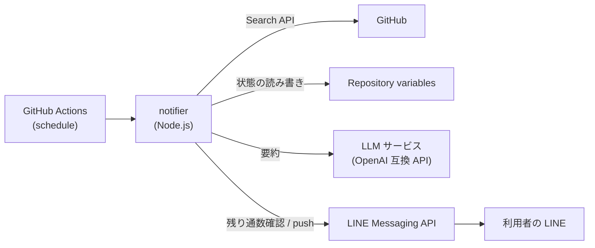

# 設計

要件は [requirements.md](requirements.md) を参照。

## 1. 全体構成



## 2. 技術スタック

| 項目 | 採用 |
| --- | --- |
| 言語 | TypeScript |
| ランタイム | Node.js(LTS) |
| 実行方式 | `tsc` でビルドした JavaScript を実行 |
| パッケージマネージャー | pnpm |
| テスト | Vitest |
| Lint / フォーマット | Biome |
| 設定ファイルの読み込み | `yaml` |
| 設定ファイルの検証 | Zod |
| GitHub API | `@octokit/rest` |
| LINE Messaging API | `@line/bot-sdk` |
| LLM(要約) | `fetch` で OpenAI 互換 API を直接呼び出す |

## 3. 処理の流れ

1. `config.yml` を読み込み、Zod で検証する。不正な場合はエラーで終了する
2. Repository variables から状態を読み込む
   - 状態がない(初回実行)場合は、実行開始時刻を `lastCheckedAt` として保存して終了する
3. 監視対象リポジトリごとに Search API で Issue を検索する(4 章)
4. 通知済みの Issue を除外する。残りが 0 件なら `lastCheckedAt` だけ更新して終了する
5. 要約が有効なら、LLM で全件をまとめて要約する(7 章)。失敗した場合は要約なしで続行する
6. 通知メッセージを組み立てる(6 章)
7. LINE の当月の残り通数を確認する。残っていなければ状態を更新せずに正常終了する
8. LINE に push する。失敗した場合は状態を更新せずに異常終了する
9. 状態を更新する(5 章)

## 4. Issue の検索

リポジトリごとに次のクエリで Search API(`GET /search/issues`)を呼び出す。

```text
repo:{owner}/{repo} is:issue is:open label:"{label1}","{label2}" updated:>={since}
```

- `label:"a","b"` は「いずれかのラベルが付いている」という意味になる
- ラベルが後から付いた Issue も拾えるよう、作成日時ではなく更新日時(`updated`)で絞り込む
- `since` は `lastCheckedAt` から 10 分前の時刻にする。検索インデックスへの反映の遅れによる取りこぼしを防ぐためで、重複分は通知済みの記録で除外する
- 結果が複数ページになる場合はすべて取得する

## 5. 状態

Repository variable `ISSUE_LINE_NOTIFIER_STATE` に JSON で保存する。

```json
{
  "lastCheckedAt": "2026-10-30T12:00:00Z",
  "notified": ["owner/repo#123", "owner/repo#124"]
}
```

| 項目 | 内容 |
| --- | --- |
| `lastCheckedAt` | 前回、正常に確認を終えた実行の開始時刻 |
| `notified` | 通知済み Issue。古い順に並べる |

- 更新時は、今回通知した Issue(「他 N 件」に含めたものも含む)を `notified` の末尾に追加する
- `notified` が上限件数(`maxNotifiedHistory`)を超えたら、先頭(古いもの)から削除する
- `lastCheckedAt` には実行の開始時刻を入れる。実行中に更新された Issue を次回の検索対象に含めるため

## 6. 通知メッセージ

1 回の実行につき、テキストメッセージを 1 通送る。

```text
【新着 Issue】3 件

■ owner/repo
タイトル
ラベル: good first issue
作成: @author 2026-10-30 21:00
本文の冒頭(100 文字)...
要約: 日本語の要約
https://github.com/owner/repo/issues/123

■ ...

他 2 件
```

- 日時は日本時間(JST)で表示する
- 5,000 文字に収まる件数まで詳細を載せ、収まらない分は「他 N 件」と件数だけ表示する

## 7. 日本語要約

OpenAI 互換の Chat Completions API(`POST {baseUrl}/chat/completions`)を `fetch` で呼び出す。

- 認証:Secret `SUMMARY_API_KEY` が設定されていれば `Authorization: Bearer` ヘッダーで送る
- 1 回の実行で見つかった Issue をまとめて 1 リクエストで送る
  - 各 Issue のキー(`owner/repo#123`)・タイトル・ラベル・本文を JSON にして渡す
  - トークン数を抑えるため、本文は先頭から一定の文字数に切り詰める
- LLM には、キーごとの要約を JSON オブジェクトで返すよう指示する

  ```json
  { "owner/repo#123": "日本語の要約" }
  ```

- 応答の検証
  - コードブロック(```)で囲まれている場合は取り除いてから JSON として読む
  - Zod で検証し、送ったキーに対応する要約だけを使う
- 一定時間で応答がない場合はタイムアウトさせる
- 通信エラー・タイムアウト・応答の形式不正のいずれも、警告をログに出して要約なしで続行する

## 8. 設定ファイル

リポジトリ直下の `config.yml`。

```yaml
repositories:
  - name: owner/repo
    labels:
      - good first issue
      - help wanted

bodyPreviewLength: 100  # 本文冒頭の表示文字数(省略時 100)
maxNotifiedHistory: 1000  # 通知済み Issue の保持件数(省略時 1000)

summary:
  enabled: true  # 日本語要約を使うか(summary ごと省略した場合は無効)
  baseUrl: https://api.example.com/v1  # OpenAI 互換 API の接続先
  model: model-name  # 利用するモデル名
```

- `summary.enabled` が `true` の場合は、`baseUrl` と `model` を必須とする
- 実行間隔は設定ファイルではなく、workflow の `cron` で指定する

## 9. GitHub Actions workflow

`.github/workflows/notify.yml`

- トリガー:`schedule`(デフォルト 30 分ごと)と、動作確認用の `workflow_dispatch`
- `concurrency` を指定し、実行が重ならないようにする(状態の上書きを防ぐ)
- `permissions`:`contents: read`

### Secrets

| 名前 | 内容 |
| --- | --- |
| `LINE_CHANNEL_ACCESS_TOKEN` | Messaging API のチャネルアクセストークン |
| `LINE_USER_ID` | 送信先(利用者本人)のユーザー ID |
| `STATE_TOKEN` | Fine-grained PAT(権限:Variables の Read and write) |
| `SUMMARY_API_KEY` | LLM サービスの API キー(要約を使う場合のみ。不要なサービスでは省略可) |

Issue の検索には Actions の `GITHUB_TOKEN` を使う。

## 10. ディレクトリ構成

```text
.
├── .github/workflows/notify.yml
├── config.example.yml
├── docs/
├── src/
│   ├── main.ts      # エントリーポイント。処理の流れを組み立てる
│   ├── config.ts    # 設定ファイルの読み込みと検証
│   ├── state.ts     # 状態の読み書き
│   ├── github.ts    # Issue の検索
│   ├── summary.ts   # LLM による要約
│   ├── message.ts   # 通知メッセージの組み立て
│   └── line.ts      # 残り通数の確認と push
└── test/
```

外部 API を呼ぶモジュール(`state.ts`・`github.ts`・`summary.ts`・`line.ts`)と、純粋な処理(`config.ts` の検証・`message.ts`)を分け、純粋な処理を中心にテストする。
